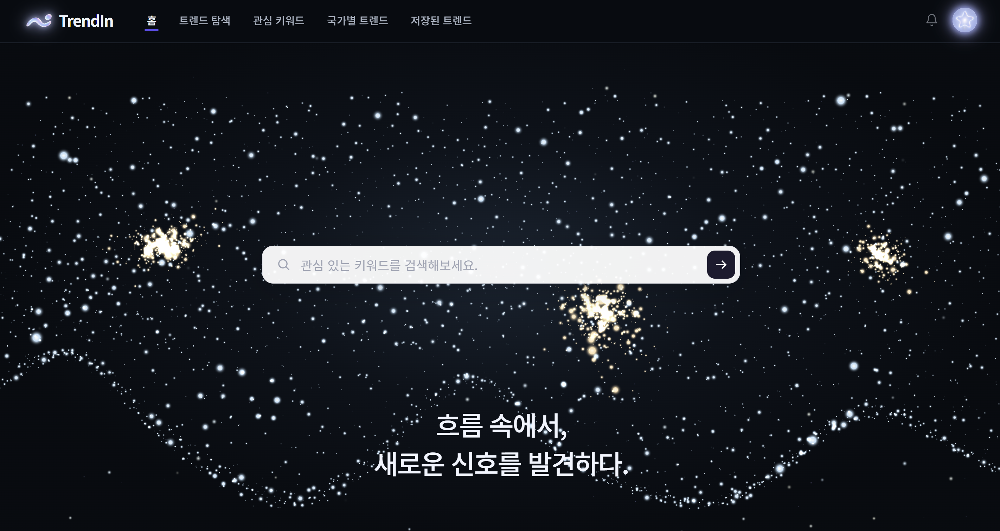
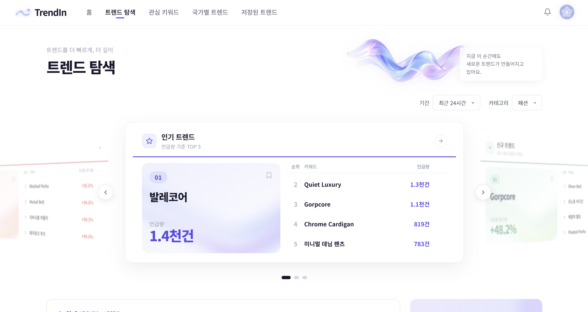
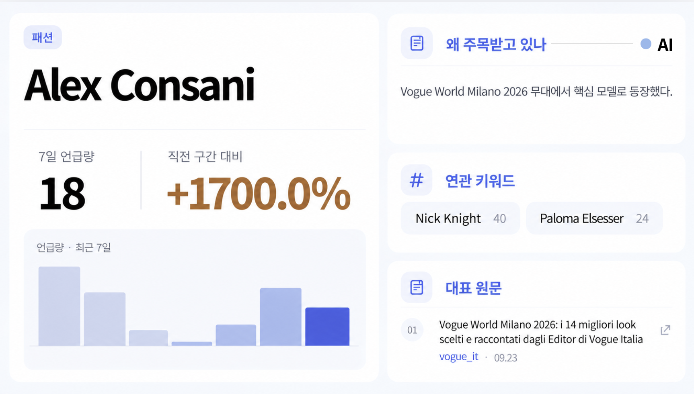
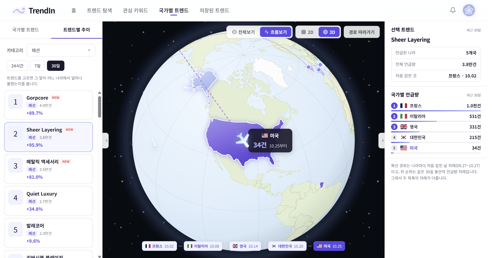
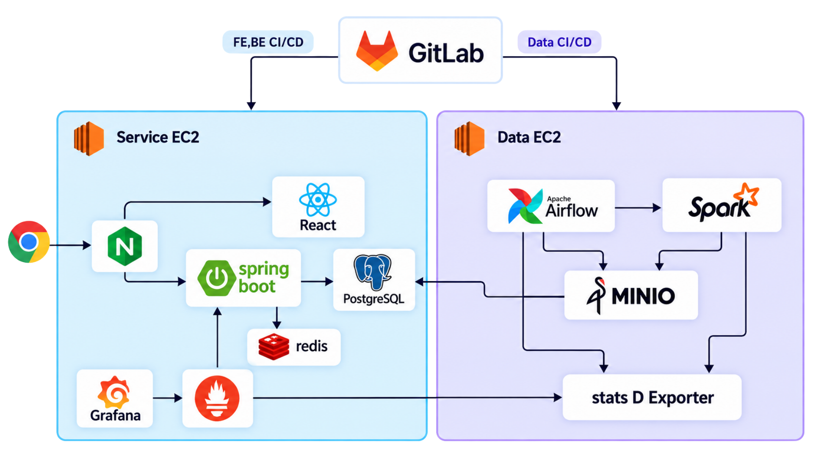

<div align="center">

# TrendIn

**흐름 속에서, 새로운 신호를 발견하다.**

흩어진 매체의 신호를 모아 새로 떠오르는 흐름과 그 이유까지 한 화면에서 읽는 트렌드 탐지·분석 플랫폼


<p align="center"><a href="https://spring.io/projects/spring-boot"></a> <a href="https://react.dev"></a> <a href="https://airflow.apache.org"></a> <a href="https://spark.apache.org"></a> <a href="https://www.postgresql.org"></a></p>

**[🌐 서비스 바로가기](https://j15a102.p.ssafy.io)** · **[📑 발표 자료](https://6candoit.my.canva.site/trendin)**

</div>

---

## 목차

- [서비스 소개](#서비스-소개)
- [핵심 기능](#핵심-기능)
- [화면 흐름 · 주요 화면](#화면-흐름)
- [시스템 아키텍처](#시스템-아키텍처)
- [기술 스택](#기술-스택)
- [팀 구성](#팀-구성)
- [실행 방법](#실행-방법)
- [프로젝트 구조](#프로젝트-구조)
- [관련 문서](#관련-문서)

---

## 서비스 소개

> **"요즘 뭐가 뜨는지 알려면, 대체 몇 군데를 돌아봐야 할까?"**

**TrendIn** 은 매체 41곳의 기사를 대신 모아, 지금 떠오르는 트렌드와 그 흐름을 **한 화면에서** 보여 주는 트렌드 분석 플랫폼입니다.

| 기존의 불편 | TrendIn 에서는 |
| --- | --- |
| 매체 · SNS · 커뮤니티를 직접 오가며 찾아야 한다 | **한곳에서** 모아 본다 |
| 언제부터 떴는지, 오르는 중인지 알기 어렵다 | **시계열 추이**로 흐름을 본다 |
| 이미 자리 잡은 인기 순위만 보인다 | **신규 · 급상승**으로 초기 움직임을 잡는다 |
| 왜 뜨는지는 다시 검색해야 한다 | **AI 해설과 원본 기사**가 함께 붙는다 |
| 내 키워드가 움직였는지 따로 확인해야 한다 | **관심 키워드 알림**이 온다 |

---

## 핵심 기능

### 📡 한곳에서 모아 보기

매체 41곳을 매시간 수집하고, Airflow · Spark 파이프라인이 정제부터 키워드 추출 · 분석까지 자동으로 처리합니다.

### 📈 시계열 추이 · 트렌드 분류

- 키워드마다 **언급량 추이 차트**와 **타임라인**으로 언제부터 떴는지 보여 줍니다
- 24시간 · 7일 · 30일 구간을 직전 구간과 비교해 **인기 · 신규 · 급상승**으로 나눕니다
- 나라별 최초 등장일을 이어 지구본 위에서 **확산 경로**를 따라갑니다

### 🧠 AI 해설 & 원본 소스

LLM 이 원본 기사를 읽고 **"무엇이고 왜 지금 뜨는가"** 를 정리하고, 근거 기사와 원문 링크를 함께 보여 줍니다.

### 🎯 관심 키워드 & 알림

관심 키워드를 담으면 연관 키워드를 추천하고, 급등 · 급락 · 신규 진입 시 알림을 보냅니다.

> 전체 기능 114개는 [`docs/plan/requirements.md`](docs/plan/requirements.md) 에 정리돼 있습니다.

---

## 화면 흐름

```
①  홈                    파티클 물결 · 트렌드 검색 · 오늘의 트렌드 3판
        ↓
②  로그인 / 온보딩        이메일 또는 GitLab 소셜 로그인 → 관심 분야·키워드·알림 설정
        ↓
③  트렌드 탐색            분야·기간 필터, 인기·신규·급상승 순위판, 연관 키워드
        ↓
④  트렌드 상세            지표 · 추이 차트 · AI 해설 · 원본 소스 · 연관 키워드 · 타임라인

    ├─ 관심 키워드        등록한 키워드 관리와 추천
    ├─ 국가별 트렌드      나라 축 / 트렌드 축 두 갈래, 지도와 확산 경로
    ├─ 저장된 트렌드      담아 둔 트렌드 모아 보기
    └─ 마이페이지         프로필 · 알림 설정 · 최근 활동 · 데이터 내보내기
```

### 주요 화면

<table>
  <tr>
    <th width="25%">🏠 홈</th>
    <th width="25%">🔍 트렌드 탐색</th>
    <th width="25%">📊 트렌드 분석</th>
    <th width="25%">🌏 트렌드 흐름보기</th>
  </tr>
  <tr>
    <td><a href="docs/images/screen-home.png"></a></td>
    <td><a href="docs/images/screen-explore.png"></a></td>
    <td><a href="docs/images/screen-detail.png"></a></td>
    <td><a href="docs/images/screen-timeline.png"></a></td>
  </tr>
  <tr>
    <td>파티클 물결 위에서 관심 키워드를 바로 검색</td>
    <td>기간·분야별 인기 · 신규 · 급상승 TOP 5 순위판</td>
    <td>언급량 · 증가율 · 추이 차트 · AI 해설 · 연관 키워드 · 대표 원문</td>
    <td>나라별 최초 등장일을 이어 지구본 위에서 확산 경로 추적</td>
  </tr>
</table>

> 이미지를 누르면 원본 크기로 볼 수 있습니다.

---

## 시스템 아키텍처



운영은 **EC2 2대**로 서비스와 데이터 처리를 나눕니다.

| 서버 | 구성 | 역할 |
| --- | --- | --- |
| **Service EC2** | Nginx · React · Spring Boot · PostgreSQL · Redis · Prometheus · Grafana | 사용자 요청 처리, API, 서비스 데이터 저장, 모니터링 |
| **Data EC2** | Airflow · Spark · MinIO · StatsD Exporter | 매체 수집, 정제·분석 배치, 원문·정제 결과 저장 |

- **CI/CD**: GitLab 이벤트를 기준으로 FE·BE 는 Jenkins, Data(datastore · pipeline) 는 GitLab CI 로 나눠 배포합니다.
- **데이터 적재**: Data EC2 의 Spark 가 분석 결과를 Service EC2 의 PostgreSQL 에 직접 적재합니다.
- **관측**: Prometheus 가 서비스 EC2 메트릭과 Data EC2 의 StatsD Exporter(Airflow · Spark 메트릭)를 함께 수집하고 Grafana 로 봅니다.

**데이터 파이프라인 흐름**

```
fashion_collect (매시 정각)
   │  매체 41곳 수집 → MinIO raw-data
   ▼  Asset
spark_ingest ──▶ extract ──▶ concept ──▶ aggregate ──▶ analyze
   정제            키워드 추출   개념 연결      구간별 지표·       LLM 해설 생성
   → curated                              유형 판정          → PostgreSQL
                                                                │
[Web] 트렌드 탐색·상세 ◀── [Backend] 조회 API · 알림 생성 배치 ◀──┘
```

단계 사이를 시각이 아닌 **자산(Asset)** 으로 연결해 앞 단계가 성공했을 때만 다음 단계가 돌고,
LLM 해설을 **배치에서 미리 생성**해 두어 화면 응답 속도와 LLM 호출 비용을 함께 관리하는 구조입니다.

---

## 기술 스택

### Frontend

| 분류 | 기술 |
| --- | --- |
| 코어 | React 19, TypeScript 5.9, Vite 7 |
| 상태·데이터 | TanStack Query 5 |
| 라우팅 | React Router 7 |
| 시각화 | three.js (파티클 물결 · 지구본) |
| 테스트·품질 | Node test runner, ESLint |

### Backend

| 분류 | 기술 |
| --- | --- |
| 코어 | Java 25, Spring Boot 4.1.1 (Web MVC / Data JPA / Security / Validation / Actuator) |
| 데이터 | PostgreSQL 17 (pgvector), Redis 8, Flyway (`V1`~`V12`, 운영 `ddl-auto: validate`) |
| 인증·보안 | Spring Security, JWT (jjwt), Redis 기반 리프레시 토큰 회전, GitLab OAuth 2.0 |
| 문서화 | Spring REST Docs |
| 테스트 | JUnit 5 |

### Data / AI

| 분류 | 기술 |
| --- | --- |
| 오케스트레이션 | Python 3.12, Apache Airflow 3.3.1 (LocalExecutor, Asset 기반 스케줄링) |
| 분산 처리 | PySpark — 정제 · 키워드 추출 · 개념 연결 · 집계 Job |
| 저장소 | MinIO (원문 `raw-data` · 정제 결과 `curated` 객체 저장) |
| AI 분석 | GMS 경유 LLM 호출, 구조화 JSON 응답 계약 검증 |
| 테스트·품질 | pytest, ruff |

### Infra / DevOps

| 분류 | 기술 |
| --- | --- |
| 서버 | Amazon EC2 2대 (서비스 / 데이터) |
| 배포 | Docker, Docker Compose, Nginx (HTTPS · SPA 정적 서빙 · API 리버스 프록시) |
| CI/CD | GitLab CI (datastore · pipeline), Jenkins (backend · frontend), GitLab Runner 2벌 |
| 관측 | Prometheus, Grafana, node_exporter, cAdvisor, StatsD exporter (Airflow 메트릭) |
| 부하 테스트 | k6 (arrival-rate 모델), 운영과 같은 이미지 · 다른 DB 로 격리 측정 |

---

## 팀 구성

| 이름 | 역할 |
| --- | --- |
| 안혜민 | **Frontend** |
| 한결 | **Backend / Infra** |
| 이세영 | **Backend** |
| 강민수 | **Data / AI** |
| 유원우 | **Data / AI** |
| 유정균 | **Data / AI / Infra** |

---

## 실행 방법

### 사전 준비

- JDK 25
- Node.js + npm
- Docker / Docker Compose (메모리 4 GB 이상 권장)
- Python 3.12 (파이프라인 로컬 개발 시)

### 1. 로컬에서 바로 띄우기 (Backend + Frontend)

**PostgreSQL 도 DB 덤프도 필요 없습니다.** `local` 프로파일이 인메모리 H2 를 쓰고,
기동하면서 키워드 · 트렌드 · AI 해설 · 시드 계정을 자동으로 넣습니다.

```bash
# Redis
docker run -d --name trendin-redis -p 6379:6379 redis:8

# Backend (http://localhost:8080)
cd backend
./gradlew bootRun --args='--spring.profiles.active=local'

# Frontend (http://localhost:5173) — 새 터미널
cd frontend
cp .env.example .env.local
npm ci
npm run dev
```

로그인: **`fashion@example.com` / `password123!`** — 다른 시드 계정은 [`exec/1-build-deploy.md`](exec/1-build-deploy.md#시드-계정) 참고

### 2. 데이터 파이프라인 (선택)

```bash
# MinIO 먼저
cd datastore
cp .env.example .env
docker compose up -d

# Airflow
cd ../pipeline
cp .env.example .env        # AIRFLOW_UID, 비밀번호, JWT 시크릿, MinIO 키 채우기
docker compose up -d --build
docker compose ps           # 전부 healthy 인지 확인
```

Airflow UI: `http://127.0.0.1:8080` (서버에서는 SSH 터널로만 접근)

> ⚠️ 수집 DAG 는 **외부 매체 사이트에 실제 요청**을 보냅니다.
> 실행 전 [`pipeline/README.md`](pipeline/README.md) 의 수집 운영 절을 먼저 확인하세요.

### 3. 테스트

```bash
cd backend  && ./gradlew test                          # JUnit 5
cd frontend && npm test && npm run lint                # Node test runner · ESLint
cd pipeline && ./scripts/dev-setup.sh && .venv/bin/pytest   # pytest
```

### 4. 부하 테스트 (선택)

운영과 같은 이미지를 다른 DB 로 띄워 격리 측정합니다. 절차는 [`docs/load-test/README.md`](docs/load-test/README.md) 참고

---

## 프로젝트 구조

```
.
├── backend/                  # Spring Boot API 서버
│   └── src/main/java/com/forever102/
│       ├── auth/             # 이메일·OAuth 로그인, JWT 발급과 회전
│       ├── member/           # 회원 정보, 관심 분야, 관심 키워드, 탈퇴
│       ├── trend/            # 트렌드 조회, 추이, 콘텐츠, 연관 키워드, 나라별 집계
│       ├── notification/     # 알림 생성 배치, 알림 설정, 읽음 처리
│       └── global/           # 예외 처리, 보안 설정, 공통 응답 봉투
│
├── frontend/                 # React SPA
│   └── src/
│       ├── pages/            # Landing, Login, SignUp, Onboarding, Home(탐색),
│       │                     #   Keywords, GlobalTrends, SavedTrend, TrendDetail, MyPage
│       ├── features/         # auth · trend · myPage · notification · globalTrend · savedTrend
│       └── components/       # 공용 레이아웃과 UI 조각
│
├── pipeline/                 # Airflow DAG 과 Spark Job
│   ├── dags/
│   │   ├── fashion/          # fashion_collect — 패션 매체 41곳, 매시 정각
│   │   └── pipeline/         # spark_ingest → extract → concept → aggregate → analyze
│   └── src/trendin/
│       ├── common/collect/   # 수집 DAG 공용 틀
│       ├── fashion/          # 패션 분야 수집 어댑터
│       ├── spark/            # 정제·추출·개념·집계 Job
│       └── ai/               # LLM 프롬프트와 응답 계약
│
├── datastore/                # MinIO — raw-data(원문) · curated(정제 결과)
├── infra/                    # Nginx, Compose, Jenkins 파이프라인, Prometheus/Grafana
├── exec/                     # 포팅 매뉴얼 — 빌드·배포, 외부 서비스, DB 덤프, 시연 시나리오
└── docs/                     # 요구사항 명세, API 설계, ERD, 배포·부하테스트 가이드
    └── load-test/            # k6 부하테스트 시나리오와 결과 리포트
```

---

## 관련 문서

| 문서 | 설명 |
| --- | --- |
| [발표 자료 (Canva)](https://6candoit.my.canva.site/trendin) | **프로젝트 최종 발표 자료** |
| [docs/plan/requirements.md](docs/plan/requirements.md) | 요구사항 명세 — 기능 114개와 분야 확장 계획 |
| [docs/api/api.md](docs/api/api.md) | API 설계 — 엔드포인트 36개와 Request/Response 예시 |
| [docs/erd/erd.md](docs/erd/erd.md) | ERD — 표 16개와 관계 |
| [pipeline/docs/data-pipeline-design.md](pipeline/docs/data-pipeline-design.md) | 파이프라인 설계 — 버킷 계약과 단계별 규칙 |
| [pipeline/README.md](pipeline/README.md) | Airflow 파이프라인 실행·검증 가이드 |
| [infra/README.md](infra/README.md) | 인프라 구성 — Nginx, Compose, Jenkins, 모니터링 |
| [exec/README.md](exec/README.md) | 포팅 매뉴얼 |
| [backend/docs/convention/](backend/docs/convention) | Git · Java · Spring Boot · 테스트 컨벤션 |

---

## 향후 발전 방향

현재 열려 있는 분야는 **패션** 하나이며, 최종적으로 게임 · 개발 · 패션 · 뷰티 · 음악 · 여행 · 콘텐츠 · 금융
**8개 분야**로 넓힙니다. 화면 · API · 파이프라인은 이미 분야를 축으로 두고 만들어져 있어,
분야를 여는 일은 그 분야의 수집 어댑터와 자료 경로를 채우는 일입니다.
