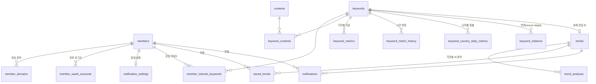

# TrendIn ERD

서비스 데이터베이스(`forever102`)의 표 구조다.

**정본은 Flyway 마이그레이션이다** — [`backend/src/main/resources/db/migration/`](../../backend/src/main/resources/db/migration/).
이 문서는 그것을 읽기 쉽게 옮긴 것이므로, 둘이 어긋나면 마이그레이션이 맞다. 스키마를 바꿀
때는 이 문서가 아니라 새 마이그레이션을 쓰고, 그 다음에 이 문서를 따라 고친다.

| | |
| --- | --- |
| DBMS | PostgreSQL 17 |
| 표 | 16개 |
| 최신 마이그레이션 | `V12__notification_member_indexes.sql` |
| 기준 시각 | 모든 `timestamp` 는 `with time zone`. 집계 구간은 KST 자정으로 끊는다 |

---

## 한눈에



읽는 법 — `||--o{` 는 1:N, `||--o|` 는 1:0..1 이다. `trends` 가 `keywords` 에 0..1 인 이유는
`uk_trends_keyword` 로 키워드당 한 행이되, **판정을 받은 키워드에만 행이 생기기** 때문이다.

---

## 1. 회원

### `members`

| 칼럼 | 타입 | 비고 |
| --- | --- | --- |
| `id` | `bigint` identity | PK |
| `email` | `varchar(254)` NOT NULL | `uk_members_email` |
| `password` | `varchar(255)` | **NULL 허용** (V8) |
| `nickname` | `varchar(30)` NOT NULL | |
| `onboarding_completed` | `boolean` NOT NULL | 기본 `false` |
| `created_at` | `timestamptz` NOT NULL | |
| `updated_at` | `timestamptz` NOT NULL | |

`password` 가 NULL 일 수 있는 이유는 **외부 로그인만 쓰는 회원** 때문이다. 아무 해시나 채워
두면 아무도 쓰지 않는 자격이 남아 공격 표면만 늘어난다. 이메일 로그인 경로는 해시가 없으면
불일치로 처리하므로, NULL 인 회원이 비밀번호로 들어올 수는 없다.

### `member_domains`

관심 분야. `member_domains_seq` (`INCREMENT BY 50`) 를 쓴다 — identity 가 아니라 Hibernate
pooled 시퀀스다.

| 칼럼 | 타입 | 비고 |
| --- | --- | --- |
| `id` | `bigint` NOT NULL | PK, 시퀀스에서 받음 |
| `member_id` | `bigint` NOT NULL | → `members` **ON DELETE CASCADE** |
| `domain` | `varchar(255)` NOT NULL | `CHECK IN ('DEVELOP', 'FASHION')` |
| `created_at` | `timestamptz` NOT NULL | |
| `updated_at` | `timestamptz` NOT NULL | |

`ux_member_domains_member_id_domain UNIQUE (member_id, domain)`

### `member_oauth_accounts`

| 칼럼 | 타입 | 비고 |
| --- | --- | --- |
| `id` | `bigint` identity | PK |
| `member_id` | `bigint` NOT NULL | → `members` **CASCADE** |
| `provider` | `varchar(30)` NOT NULL | |
| `provider_user_id` | `varchar(255)` NOT NULL | 제공자의 **불변 식별자** |
| `created_at` | `timestamptz` NOT NULL | |
| `updated_at` | `timestamptz` NOT NULL | |

제약 둘이 각자 다른 일을 한다. `uk_member_oauth_accounts_provider_user (provider,
provider_user_id)` 는 **재로그인이 같은 회원을 찾게** 하고,
`uk_member_oauth_accounts_member_provider (member_id, provider)` 는 **한 회원이 같은 제공자에
두 번 묶이는 것을 막는다.**

`provider_user_id` 가 이메일이 아닌 이유 — 제공자의 이메일은 바뀐다. 이메일로 맞추면 주소를
바꾸는 순간 남의 계정으로 들어갈 수 있다. `varchar` 인 이유는 제공자마다 식별자 모양이
달라서다(정수·UUID·불투명 문자열).

### `notification_settings`

| 칼럼 | 타입 | 비고 |
| --- | --- | --- |
| `id` | `bigint` identity | PK |
| `member_id` | `bigint` NOT NULL | → `members` **CASCADE**, `uk_notification_settings_member` |
| `keyword_surge_enabled` | `boolean` NOT NULL | 기본 `true` |
| `keyword_drop_enabled` | `boolean` NOT NULL | 기본 `true` |
| `new_trend_enabled` | `boolean` NOT NULL | 기본 `true` |
| `trend_turning_point_enabled` | `boolean` NOT NULL | 기본 `true` |

회원당 한 행이고, 네 가지 알림을 각각 켜고 끈다.

---

## 2. 키워드와 콘텐츠

### `keywords`

| 칼럼 | 타입 | 비고 |
| --- | --- | --- |
| `id` | `bigint` identity | PK |
| `name` | `varchar(255)` NOT NULL | 보여 주는 이름 |
| `normalized_name` | `varchar(255)` NOT NULL | 비교용 |
| `domain` | `varchar(255)` NOT NULL | `CHECK IN ('DEVELOP', 'FASHION')` |

`uk_keywords_domain_normalized_name UNIQUE (domain, normalized_name)` — **같은 말이라도 분야가
다르면 다른 키워드다.**

### `member_interest_keywords`

| 칼럼 | 타입 | 비고 |
| --- | --- | --- |
| `id` | `bigint` identity | PK |
| `member_id` | `bigint` NOT NULL | → `members` |
| `keyword_id` | `bigint` NOT NULL | → `keywords` |
| `created_at` | `timestamptz` NOT NULL | |
| `was_trending` | `boolean` NOT NULL | 기본 `false` |
| `previous_trend_types` | `varchar(255)[]` | **NULL 허용** (V10) |

`uk_member_interest_keywords_member_keyword UNIQUE (member_id, keyword_id)`

`previous_trend_types` 가 알림의 재료다. 직전 유형을 들고 있어야 **진입·이탈·전환**을 가릴 수
있다. `NULL` 은 "아직 기준 상태를 안 잡았다" 는 뜻이고, 첫 스케줄 실행이 실제 최신
`keyword_metrics` 로 채워 오탐을 막는다.

### `contents`

| 칼럼 | 타입 | 비고 |
| --- | --- | --- |
| `id` | `bigint` identity | PK |
| `title` | `varchar(2048)` NOT NULL | V9 에서 255 → 2048 |
| `source` | `varchar(2048)` NOT NULL | V9 에서 255 → 2048 |
| `url` | `varchar(2048)` NOT NULL | V9 에서 255 → 2048. `uk_contents_url` |
| `body_object_key` | `text` | 본문은 DB 가 아니라 **MinIO** 에 있다 |
| `published_at` | `timestamptz` NOT NULL | 소스가 밝힌 발행 시각 |
| `collected_at` | `timestamptz` NOT NULL | 우리가 받은 시각 |

`uk_contents_url UNIQUE (url)`

넓힌 이유가 기록해 둘 만하다. 적재는 배치를 통째로 병합하므로 **한 행이 한도를 넘으면 병합
전체가 되돌아간다** — 2026-09-19 에 27,791건 중 6건 때문에 파이프라인이 하루 멈췄고, 증상은
쓰기 오류가 아니라 "트렌드 화면이 비었다" 로 나타났다. `url` 을 자르는 선택지는 없다. 유니크
제약이 걸려 있고 파이프라인이 전체 문자열의 sha256 으로 `pl_content_id_map` 을 키잉한다.

### `keyword_contents`

키워드 ↔ 콘텐츠 N:M. 대리 키가 없고 두 칼럼이 곧 PK 다.

| 칼럼 | 타입 | 비고 |
| --- | --- | --- |
| `content_id` | `bigint` NOT NULL | PK 1번, → `contents` |
| `keyword_id` | `bigint` NOT NULL | PK 2번, → `keywords` |

⚠️ 선두 칼럼이 `content_id` 라 **`keyword_id` 단독 조회는 이 PK 를 타지 못한다.**
`GET /trends/{id}/contents` 가 그 조회이고, 부하테스트에서 이 엔드포인트가 무너진 자리다
([부하테스트 리포트](../load-test/k6/results/report/성능개선-전-2026-09-21.md)).

---

## 3. 지표

셋 다 `keywords` 에 딸리지만 **자르는 축이 다르다.**

| 표 | 축 | 유니크 |
| --- | --- | --- |
| `keyword_metrics` | 기간(24H·7D·30D) | `(keyword_id, period)` |
| `keyword_metric_history` | 시간 버킷 | `(keyword_id, bucket_start)` |
| `keyword_country_daily_metrics` | 나라 × 날짜 | `(keyword_id, metric_date, country_code)` |

### `keyword_metrics`

| 칼럼 | 타입 | 비고 |
| --- | --- | --- |
| `id` | `bigint` identity | PK |
| `keyword_id` | `bigint` NOT NULL | FK |
| `period` | `metric_period` NOT NULL | enum |
| `period_start` | `timestamptz` NOT NULL | 구간 시작. **포함** |
| `period_end` | `timestamptz` NOT NULL | 구간 끝. **제외** (`[start, end)`) |
| `mention_count` | `bigint` NOT NULL | 이번 구간 언급량 |
| `previous_mention_count` | `bigint` NOT NULL | 직전 구간 언급량 |
| `growth_amount` | `bigint` NOT NULL | 두 값의 차 |
| `growth_rate` | `numeric(38,2)` | 직전 구간이 0이면 낼 수 없어 NULL |
| `mention_rank` | `integer` | **분야 전체의 언급량 순위** |
| `trend_types` | `varchar(255)[]` NOT NULL | 기본 `'{}'` (V3) |

제약이 둘이다. 엔티티가 선언한 `uk_keyword_metrics_period` 는 네 칼럼
`(keyword_id, period, period_start, period_end)` 이고, V2 가 더한
`uk_keyword_metrics_keyword_period` 는 **두 칼럼**이다. 앞의 것만으로는 구간 경계가 키에
들어가 있어, 날짜가 넘어간 배치가 같은 키워드·기간에 **두 번째 행을 만든다.**

⚠️ **`mention_rank` 를 화면의 순위로 쓰면 안 된다.** 분야 전체의 언급량 순위라, 증가율로 줄을
세우는 급상승 판에서는 251·35·52 처럼 뒤섞인다. 판에 보이는 번호는 받은 차례를 쓴다.

**`trend_types` 가 여기 있는 이유** — 원래 `trends` 에 있었는데 그 표에는 기간 칸이 없어 세
기간의 판정을 합집합으로 담아야 했다. 30일 기준으로만 RISING 인 키워드가 7일 목록에 그 기간의
증가율을 달고 나타나 모순으로 읽혔다. `keyword_metrics` 는 이미 `(keyword_id, period)` 로
유일하므로 판정이 있어야 할 자리가 여기다.

### `keyword_metric_history`

| 칼럼 | 타입 | 비고 |
| --- | --- | --- |
| `id` | `bigint` identity | PK |
| `keyword_id` | `bigint` NOT NULL | → `keywords` |
| `bucket_start` | `timestamptz` NOT NULL | 버킷 시작. **포함** |
| `bucket_end` | `timestamptz` NOT NULL | 버킷 끝. **제외** |
| `mention_count` | `bigint` NOT NULL | 그 버킷의 언급량 |

그래프의 재료다. 시드 기준 **450만 행**으로 이 데이터베이스에서 가장 크다.

### `keyword_country_daily_metrics`

| 칼럼 | 타입 | 비고 |
| --- | --- | --- |
| `id` | `bigint` identity | PK |
| `keyword_id` | `bigint` NOT NULL | FK |
| `country_code` | `varchar(2)` NOT NULL | `CHECK ~ '^[A-Z]{2}$'` (ISO 3166-1 alpha-2) |
| `metric_date` | `date` NOT NULL | **KST 달력일** |
| `mention_count` | `bigint` NOT NULL | `CHECK >= 0` |

`ix_keyword_country_daily_metrics_date (metric_date, country_code)` 가 따로 있다. "이 나라에서
이 날 많이 나온 키워드" 는 선두가 `keyword_id` 인 유니크 인덱스를 못 쓴다.

`char` 가 아니라 `varchar` 인 이유는 `char` 가 공백을 채워 넣고 그 패딩이 동등 비교에
새어 들기 때문이다. enum 이 아니라 `CHECK` 인 이유는 **나라를 하나 더하는 데 마이그레이션이
필요하지 않게** 하려는 것이다.

### `keyword_relations`

| 칼럼 | 타입 | 비고 |
| --- | --- | --- |
| `source_keyword_id` | `bigint` NOT NULL | PK 1번, → `keywords` |
| `target_keyword_id` | `bigint` NOT NULL | PK 2번, → `keywords` |
| `relation_score` | `numeric(5,2)` NOT NULL | `CHECK BETWEEN 0 AND 100` |
| `co_occurrence_count` | `bigint` NOT NULL | |
| `updated_at` | `timestamptz` NOT NULL | |

PK 선두가 `source_keyword_id` 라 "이 키워드의 연관 키워드" 조회는 인덱스를 탄다.

---

## 4. 트렌드와 분석

### `trends`

**지금은 상세 진입 ID 일 뿐이다.**

| 칼럼 | 타입 | 비고 |
| --- | --- | --- |
| `id` | `bigint` identity | PK |
| `keyword_id` | `bigint` NOT NULL | `uk_trends_keyword`, FK |
| `updated_at` | `timestamptz` NOT NULL | |

V1 에는 `trend_types` · `description` · `summary` · `reason` 이 있었으나 **V7 이 넷 다
드롭했다.** 배지는 `keyword_metrics` 로, AI 문구는 `trend_analyses` 로 옮겨 갔다.

⚠️ 파이프라인 적재가 드롭된 칼럼에 계속 쓰다가 전체가 멈춘 적이 있다. 이 표에 INSERT 하는
코드를 고칠 때는 **V7 이후 형태**인지 확인한다.

### `trend_analyses`

| 칼럼 | 타입 | 비고 |
| --- | --- | --- |
| `id` | `bigint` identity | PK |
| `trend_id` | `bigint` NOT NULL | → `trends` **CASCADE** |
| `period` | `metric_period` NOT NULL | |
| `trend_types` | `varchar(255)[]` NOT NULL | 분석 당시의 판정 |
| `description` | **`varchar(255)`** NOT NULL | 한 줄 요약 |
| `summary` | `text` | 현재 모습과 흐름 |
| `reason` | `text` | 지금 뜨는 이유 |
| `input_fingerprint` | `varchar(64)` | 입력 해시. 같으면 AI 를 다시 부르지 않는다 |
| `analyzed_at` | `timestamptz` NOT NULL | |

`uk_trend_analyses_trend_period UNIQUE (trend_id, period)`

⚠️ **`description` 만 255자 한도가 있다.** `summary` · `reason` 은 `text` 라 한도가 없다.
생성 쪽 계약이 이 길이를 알고 있어야 하며, 모르면 긴 응답이 저장 단계에서 잘려 그 키워드의
분석이 통째로 사라진다.

---

## 5. 개인화

### `saved_trends`

| 칼럼 | 타입 | 비고 |
| --- | --- | --- |
| `id` | `bigint` identity | PK |
| `member_id` | `bigint` NOT NULL | → `members` **CASCADE** |
| `trend_id` | `bigint` NOT NULL | → `trends` **RESTRICT** |
| `created_at` | `timestamptz` NOT NULL | 담은 시각 |

`uk_saved_trends_member_trend UNIQUE (member_id, trend_id)`

FK 의 방향이 다르다 — `member_id` 는 **CASCADE**(회원이 나가면 저장도 사라진다),
`trend_id` 는 **RESTRICT**(누군가 담아 둔 트렌드는 지울 수 없다).

### `notifications`

| 칼럼 | 타입 | 비고 |
| --- | --- | --- |
| `id` | `bigint` identity | PK |
| `member_id` | `bigint` NOT NULL | → `members` |
| `trend_id` | `bigint` NOT NULL | → `trends` |
| `notification_type` | `varchar(30)` NOT NULL | `CHECK` 다섯 값 |
| `message` | `varchar(255)` NOT NULL | |
| `is_read` | `boolean` NOT NULL | |
| `created_at` | `timestamptz` NOT NULL | |
| `dedup_key` | `varchar(255)` NOT NULL | `uk_notifications_dedup_key` |

허용 유형(V10) — `TREND_CHANGE` · `KEYWORD_SURGE` · `KEYWORD_DROP` · `NEW_TREND` ·
`TREND_TURNING_POINT`.

**인덱스 둘이 V12 에서 붙었다.** 그전에는 PK 와 `dedup_key` 뿐이었고, PostgreSQL 은 외래키에
인덱스를 만들어 주지 않는데 조회는 전부 `member_id` 로 시작해 매번 전체를 훑었다.

```sql
idx_notifications_member_created  (member_id, created_at DESC, id DESC)
idx_notifications_member_unread   (member_id) WHERE is_read = false
```

앞의 것은 **정렬 순서까지 맞춰** 목록이 인덱스를 20행만 걷고 멈추게 한다. 뒤의 것은 부분
인덱스로, 안 읽은 개수 세기가 인덱스만 읽고 끝난다. 실측으로 목록 p95 900.5ms → 7.3ms,
안 읽은 개수 608.1ms → 4.4ms 가 됐다
([리포트](../load-test/k6/results/report/성능개선-후-2026-09-22.md)).

---

## 6. 사용자 정의 타입

| 이름 | 정의 | 쓰는 곳 |
| --- | --- | --- |
| `metric_period` | `ENUM ('24H', '7D', '30D')` | `keyword_metrics.period` · `trend_analyses.period` |
| `trend_type` | `DOMAIN varchar(255) CHECK IN ('CURRENT','RISING','NEW')` | **없음** |

`trend_type` 도메인은 V1 이 만들었지만 **어느 칼럼도 쓰지 않는다.** 배지를 담는
`keyword_metrics.trend_types` 와 `trend_analyses.trend_types` 는 둘 다 `varchar(255)[]` 다 —
엔티티가 `@JdbcTypeCode(SqlTypes.ARRAY)` 로 매핑하고 V1 이 그 모양으로 선언했기 때문이다.
지우려면 마이그레이션이 필요하므로 현재는 남겨 둔다.

---

## 엔티티 ↔ 표

| JPA 엔티티 | 표 |
| --- | --- |
| `Member` | `members` |
| `MemberDomain` | `member_domains` |
| `MemberOAuthAccount` | `member_oauth_accounts` |
| `NotificationSetting` | `notification_settings` |
| `MemberInterestKeyword` | `member_interest_keywords` |
| `Keyword` | `keywords` |
| `Content` | `contents` |
| `KeywordMetric` | `keyword_metrics` |
| `KeywordMetricHistory` | `keyword_metric_history` |
| `KeywordCountryDailyMetric` | `keyword_country_daily_metrics` |
| `KeywordRelation` | `keyword_relations` |
| `Trend` | `trends` |
| `TrendAnalysis` | `trend_analyses` |
| `SavedTrend` | `saved_trends` |
| `Notification` | `notifications` |
| — | `keyword_contents` (엔티티 없음, 질의로만 읽는다) |

`ddl-auto` 는 `validate` 다. 스키마를 만드는 것은 Flyway 뿐이고 Hibernate 는 맞는지만 본다.
다만 **`validate` 는 칼럼 길이를 비교하지 않는다** — `varchar` 폭이 바뀌어도 기동은 통과한다.
